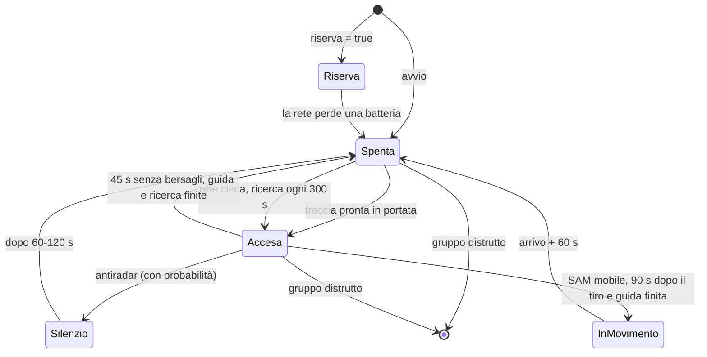

# IADS: come funziona il codice

Questo documento spiega cosa fa il codice della cartella `iads/`, come è organizzato e perché.
Per installare lo script in una missione e scrivere la configurazione vedi il [README](README.md).

## Indice
1. [Panoramica](#1-panoramica)
2. [I file della cartella](#2-i-file-della-cartella)
3. [Caricamento e avvio](#3-caricamento-e-avvio)
4. [Lo stato in memoria](#4-lo-stato-in-memoria)
5. [Il ciclo della rete](#5-il-ciclo-della-rete)
6. [Gli eventi di lancio](#6-gli-eventi-di-lancio)
7. [Profili per tipo di radar](#7-profili-per-tipo-di-radar)
8. [Tempi: dall'avvistamento all'accensione](#8-tempi-dallavvistamento-allaccensione)
9. [Funzioni di DCS usate](#9-funzioni-di-dcs-usate)
10. [La prova fuori dal gioco](#10-la-prova-fuori-dal-gioco)
11. [Punti aperti noti](#11-punti-aperti-noti)

---

## 1. Panoramica

`iads.lua` comanda i radar dei SAM di una o più coalizioni come una rete di difesa aerea
integrata. L'idea centrale è che la rete **non è onnisciente**:

- una batteria tiene il radar spento finché la rete non le segnala un bersaglio nella sua portata;
- la rete conosce solo gli aerei e gli elicotteri che i suoi sensori rilevano davvero, attraverso
  le funzioni di rilevamento di DCS. Orizzonte radar e rilievo li calcola il simulatore;
- le informazioni arrivano in ritardo, e alcune non arrivano affatto (AWACS);
- anche la reazione agli antiradar dipende da ciò che la rete vede.

Lo script è un unico file senza dipendenze (niente MOOSE, MIST o modifiche a
`MissionScripting.lua`). Tutto il lavoro avviene in due punti:

| Meccanismo | Frequenza | Cosa fa |
|---|---|---|
| `giro` → `ciclo` | ogni `CICLO` = 10 s, per coalizione | raccoglie le tracce dai sensori e decide quali batterie accendere o spegnere |
| `gestore:onEvent` | a ogni `S_EVENT_SHOT` | reagisce ai lanci: antiradar nemici, oppure missili sparati dalle batterie |

---

## 2. I file della cartella

| File | Contenuto |
|---|---|
| `iads.lua` | lo script |
| `esempio_config.lua` | configurazione d'esempio (`IADS_DATI`) da caricare prima di `iads.lua` |
| `README.md` | istruzioni per chi crea la missione: installazione, configurazione, parametri, limiti |
| `DOCUMENTAZIONE.md` | questo documento |
| `test/mock_dcs.lua` | un DCS simulato minimo: `env`, `timer`, `world`, `land`, `trigger`, `Object` |
| `test/prova_iads.py` | prova automatica che esegue `iads.lua` nel DCS simulato (Python + `lupa`) |

### Struttura di `iads.lua`

Il file è diviso in sezioni, nell'ordine in cui le trova Lua:

| Sezione | Contenuto principale |
|---|---|
| Intestazione | descrizione e formato della configurazione |
| Compatibilità con la campagna | `LEVANTE.debug` e `LEVANTE.annota` (vedi §3) |
| Parametri | costanti regolabili (`CICLO`, `RITARDO_RETE`, `TENUTA`, `GUIDA`, `ANTIRADAR`…) |
| Profili | `PROFILI_SAM`, `PROFILI_SENSORI`, `PROFILO_RUOLO` (vedi §7) |
| Funzioni di servizio | `gruppoVivo`, `cercaProfilo`, `profiloSensore`, `centro`, `radar` |
| Sensori della rete | `raccogliTracce` |
| Ciclo della rete | `ciclo` |
| Antiradar e spostamento | `eAntiradar`, `silenzio`, `reteVede`, `minacciata`, `reazioneHarm`, `spostaDopoTiro`, `gestore:onEvent` |
| Avvio | costruzione dello stato, radar spenti, avvio del ciclo con `giro` |

---

## 3. Caricamento e avvio

Nel Mission Editor un trigger MISSION START esegue prima la configurazione e poi `iads.lua`.
Quando Lua esegue il file succede questo, in ordine:

1. **Compatibilità con la campagna.** Lo script nasce dalla campagna "Fuoco sul Levante 1989",
   che ha un proprio `levante_core.lua`. Se quel file non c'è, `iads.lua` crea la tabella globale
   `LEVANTE` con due funzioni:
   - `LEVANTE.debug(m)` scrive `[IADS DEBUG] m` nel `dcs.log` e, se `IADS_DEBUG = true`, anche a
     schermo per 10 s;
   - `LEVANTE.annota(chiave, dati)` non fa nulla; nella campagna registra gli eventi
     (silenzi per antiradar, spostamenti).
2. **Lettura della configurazione.** `DATI = IADS_DATI or LEVANTE_IADS or {}`. Il secondo nome è
   quello usato dalla campagna.
3. **Registrazione del gestore degli eventi** con `world.addEventHandler(gestore)`.
4. **Costruzione dello stato**, per ogni coalizione presente in `DATI`:
   - ogni SAM diventa una *batteria* in `S[coal].batterie`. Lo script cerca il profilo del suo tipo
     di radar (§7), scrive nel `dcs.log` il profilo trovato e mette il gruppo a radar spento
     (`radar(nome, false)`, protetto da `pcall` perché il gruppo potrebbe non esistere);
   - ogni sensore diventa una voce in `S[coal].sensori`. Il sensore può essere scritto come stringa
     (`"radar"`) o come tabella (`{ ruolo = "awacs", p_passa = 0.6 }`); entrambe le forme diventano
     `{ ruolo, cfg }`. Il profilo del sensore si risolve più tardi, la prima volta che il gruppo
     esiste (così funziona anche un AWACS attivato dopo l'inizio);
   - nel log compare `[IADS] coalizione N: M batterie, radar spenti`.
5. **Avvio del ciclo.** Il primo `giro` parte 5 s dopo; da lì in poi `giro` restituisce
   `ora + CICLO` e DCS lo richiama ogni 10 s. Ogni coalizione viene elaborata dentro un `pcall`:
   un errore viene scritto nel log (`[IADS] errore ciclo: ...`) ma non ferma il ciclo.

### Come lo script accende e spegne un radar

Tutto passa da `radar(nome, acceso)`:

- se il gruppo ha `enableEmission`, la chiama (con `pcall`: non tutte le versioni di DCS la hanno);
- imposta l'opzione di allarme del gruppo: **RED** per acceso, **GREEN** per spento.

In GREEN un SAM di DCS non emette e non ingaggia; in RED cerca e spara da solo. Lo script quindi non
dice mai a una batteria *su chi* sparare: decide solo *quando* può farlo.

---

## 4. Lo stato in memoria

Tutto lo stato è nella tabella locale `S`, una voce per coalizione:

```lua
S[coal] = {
  batterie      = { [nome gruppo] = batteria },
  sensori       = { [nome gruppo] = sensore },
  tracce        = { [nome unità nemica] = traccia },
  sensoriVivi   = numero di gruppi sensore ancora vivi (aggiornato a ogni ciclo),
  batteriaPersa = true dopo la prima batteria distrutta (sveglia le riserve),
}
```

### Batteria

| Campo | Da dove viene | Significato |
|---|---|---|
| `tipo` | configurazione | etichetta del sistema (`sa2`, `sa6`…), usata per il tempo di guida `GUIDA` |
| `portata` | configurazione | portata in metri; la batteria si accende entro `portata * ATTIVAZIONE` |
| `mobile` | configurazione | se `true` si sposta dopo il tiro |
| `riserva` | configurazione | se `true` resta spenta finché la rete non perde una batteria |
| `p_harm`, `p_vicine` | configurazione o profilo | probabilità di silenzio se bersaglio o minacciata da un antiradar |
| `acceso` | stato | il radar è acceso secondo lo script |
| `ultimoBersaglio` | stato | istante dell'ultimo bersaglio in portata o dell'ultimo tiro |
| `guidaFino` | stato | fino a quando il radar deve restare acceso per guidare i missili |
| `silenzioFino` | stato | fino a quando il radar è in silenzio dopo un antiradar |
| `ultimaRicerca`, `ricercaFino` | stato | ricerca autonoma della rete cieca |
| `inMovimento` | stato | la batteria si sta spostando dopo il tiro |
| `spostamentoPrevisto` | stato | uno spostamento è già programmato (evita di programmarne due) |

### Sensore

| Campo | Significato |
|---|---|
| `ruolo` | `radar` (EWR), `awacs` o `vista` (osservatori a terra) |
| `cfg` | la configurazione originale del sensore |
| `p_passa`, `ritardo` | probabilità che un rilevamento arrivi alla rete e secondi di ritardo in più; risolti al primo uso (§7) |
| `risolto` | il profilo è già stato cercato |

### Traccia

Una traccia è un aereo o elicottero nemico che la rete conosce. La chiave è il nome dell'unità.

| Campo | Significato |
|---|---|
| `x`, `y`, `z` | ultima posizione nota |
| `visto` | istante dell'ultimo rilevamento |
| `pronto` | istante da cui la traccia è utilizzabile dalle batterie (rilevamento + ritardi) |

Una traccia che non viene più rilevata per più di `3 * CICLO` = 30 s viene cancellata.

---

## 5. Il ciclo della rete

Ogni 10 s, per ogni coalizione, `ciclo(coal, ora)` fa due cose: aggiorna le tracce e poi passa le
batterie una per una.

### 5.1 Raccolta delle tracce (`raccogliTracce`)

1. **Sensori configurati.** Per ogni sensore il cui gruppo è vivo:
   - incrementa il contatore dei sensori vivi e risolve il profilo, se non è già stato fatto;
   - chiede alla **prima unità** del gruppo i bersagli rilevati: `getDetectedTargets(VISUAL, OPTIC)`
     per `vista`, `getDetectedTargets(RADAR)` per gli altri;
   - ogni rilevamento di un sensore `vista` diventa una traccia con ritardo `RITARDO_RETE`;
   - ogni rilevamento di un sensore radar o AWACS passa con probabilità `p_passa` e diventa una
     traccia con ritardo `RITARDO_RETE + ritardo` del profilo.
2. **Batterie accese.** Una batteria accesa è anche un sensore: i suoi rilevamenti radar diventano
   tracce con ritardo `RITARDO_RETE`.
3. **Pulizia.** Le tracce non viste da più di 30 s vengono cancellate.

Ogni rilevamento passa dal filtro `aggiungi`, che scarta:

- gli oggetti che non esistono più;
- tutto ciò che non è un'unità (`Object.getCategory`): missili, proiettili, razzi e bombe rilevati
  non diventano mai tracce. Il controllo serve perché per un'arma `getDesc().category` usa un'altra
  numerazione, e un missile risulterebbe un elicottero;
- le unità che non sono della coalizione nemica;
- le unità che non sono aerei o elicotteri.

Se la traccia esiste già, la posizione viene aggiornata ma l'istante `pronto` resta il più vicino:
un aereo già noto alla rete non ricomincia ad aspettare il ritardo.

### 5.2 Decisione per ogni batteria (`ciclo`)

Per ogni batteria, nell'ordine:

1. **Gruppo distrutto o inesistente** → la batteria esce dalla rete. Alla prima perdita
   `batteriaPersa` diventa `true` e le riserve si attivano. Attenzione: un gruppo con il nome
   sbagliato, o ad attivazione ritardata, è trattato come distrutto.
2. **Riserva non ancora attivata** → nessuna azione: resta spenta.
3. **In silenzio da antiradar o in movimento** → nessuna azione.
4. Altrimenti lo script cerca una traccia **pronta** (`pronto <= ora`) entro `portata * ATTIVAZIONE`
   dal centro del gruppo (distanza orizzontale, quota esclusa):
   - **c'è** → `ultimoBersaglio = ora`; se il radar era spento lo accende;
   - **non c'è, il radar è acceso**, sono passati più di `TENUTA` (45 s) dall'ultimo bersaglio e
     sono finite sia la guida dei missili sia la ricerca autonoma → spegne il radar;
   - **non c'è, il radar è spento e nessun sensore è vivo** (rete cieca) e sono passati più di
     `RICERCA_OGNI` (300 s) dall'ultima ricerca → accende il radar per `RICERCA_DURATA` (30 s).
     Mentre è acceso, la batteria fa da sensore: se trova qualcosa, la traccia può accendere
     anche le altre.

### 5.3 Stati di una batteria



"Silenzio" e "InMovimento" sono batterie con `acceso = false` che il ciclo salta finché
`silenzioFino` non è passato o `inMovimento` non torna `false`. Alla fine di questi stati la
batteria torna normale e, se c'è una traccia in portata, si riaccende al ciclo successivo.

---

## 6. Gli eventi di lancio

`gestore:onEvent` considera solo `S_EVENT_SHOT`. Il corpo è dentro un `pcall`: un errore viene
scritto nel log (`[IADS] errore evento: ...`) senza interrompere la missione.

### 6.1 Antiradar (`eAntiradar` → `reazioneHarm`)

Un'arma è un antiradar se il suo nome di tipo contiene una delle parole di `ANTIRADAR`
(`AGM_88`, `X_58`…). In quel caso:

1. **Dati del lancio.** Posizione del lanciatore, sua coalizione, direzione della prua (dal vettore
   `getPosition().x`) e, se DCS la fornisce, la batteria bersaglio (`arma:getTarget()`). Se il
   lanciatore manca o non ha posizione, non succede nulla.
2. **Quali reti reagiscono.** Solo quelle delle coalizioni diverse da quella del lanciatore, e solo
   se **in quel momento** un loro radar vede il lanciatore (`reteVede`):
   - EWR e AWACS configurati: `isTargetDetected(lanciatore, RADAR)` deve dire rilevato *e* visibile,
     poi il dato passa con la probabilità `p_passa` del sensore;
   - batterie accese: stesso controllo, senza sorteggio;
   - i sensori `vista` non contano.
3. **Quali batterie sono minacciate.** Tra le batterie accese di quella rete:
   - la batteria bersaglio, se nota → probabilità `p_harm`;
   - le altre, se entro `PORTATA_HARM` (100 km) dal lanciatore e davanti a lui, entro `CONO_HARM`
     (±45°) dalla prua (`minacciata`) → probabilità `p_vicine`.
4. **Silenzio.** Per ogni batteria che vince il sorteggio, `silenzio` programma lo spegnimento fra
   3 e 8 s (il tempo di accorgersi e reagire); allo spegnimento fissa `silenzioFino` a 60-120 s
   più avanti.

### 6.2 Tiro di una batteria della rete

Se chi spara appartiene a una batteria configurata:

- **Guida.** `guidaFino` diventa `ora + GUIDA[tipo]` (60 s se il tipo non è in tabella) e
  `ultimoBersaglio = ora`. Finché la guida non è finita il ciclo non spegne il radar, anche se il
  bersaglio è uscito dalla portata.
- **Spostamento** (solo `mobile = true`). Se non ce n'è già uno programmato, ne programma uno fra
  90 s. Allo scadere, se `guidaFino` non è ancora passato (per esempio perché la batteria ha
  sparato di nuovo), il timer si riprogramma a `guidaFino + 1` e lo spostamento aspetta: la
  batteria non spegne mai il radar mentre guida un missile. Finita la guida parte
  `spostaDopoTiro`: cerca fino a 8 volte un punto a caso a 800-1500 m che sia terreno o strada. Se
  lo trova spegne il radar, dà al gruppo un percorso fuori strada a 8 m/s e lo considera in
  movimento per `distanza / 8 + 60` secondi. Se non lo trova, la batteria resta ferma.

---

## 7. Profili per tipo di radar

Le probabilità non sono uguali per tutti i sistemi: dipendono dal tipo di unità DCS nel gruppo
(`getTypeName()`).

- `PROFILI_SAM[tipo] = { p_harm, p_vicine }`: probabilità di silenzio di una batteria.
- `PROFILI_SENSORI[tipo] = { p_passa, ritardo }`: affidabilità e ritardo di un sensore.
- `PROFILO_RUOLO[ruolo]`: valori di riserva per i sensori di tipo non elencato
  (`radar`: 1.0 e 0 s; `awacs`: `P_AWACS` e `RITARDO_AWACS`).

`cercaProfilo(g, tabella)` scorre le unità del gruppo e restituisce il profilo del **primo** tipo che
compare nella tabella. Per ogni valore vale la priorità:

1. valore scritto nella configurazione del gruppo (`p_harm`, `p_vicine`, `p_passa`, `ritardo`);
2. valore del profilo trovato in tabella;
3. valore di riserva (`P_HARM`, `P_HARM_VICINE`, `PROFILO_RUOLO`).

I profili dei SAM si risolvono all'avvio; quelli dei sensori la prima volta che il gruppo esiste.
In entrambi i casi il risultato va nel `dcs.log`, per esempio:

```
[IADS] SA-6 Bekaa: profilo Kub 1S91 str, silenzio bersaglio 0.60, minacciata 0.30
[IADS] sensore AWACS Rosso (awacs): profilo A-50, passa 0.80, ritardo +15 s
```

"di riserva" nel log vuol dire che nessuna unità del gruppo è nelle tabelle: o il tipo non è
elencato, o il suo nome in DCS è diverso da quello scritto. I valori e la loro motivazione sono nel
[README](README.md#profili-per-tipo-di-radar).

---

## 8. Tempi: dall'avvistamento all'accensione

Esempio: un aereo entra nella portata di un SA-6 ed è visto da un EWR 55G6 (ritardo extra 0).

| Istante | Cosa succede |
|---|---|
| t | l'EWR rileva l'aereo |
| t + 0…10 s | al primo ciclo successivo la traccia viene creata, `pronto = ciclo + 8 s` |
| t + 10…20 s | al ciclo dopo la traccia è pronta e il radar si accende |

In pratica la batteria si accende fra 10 e 20 s dopo il primo rilevamento; con un AWACS E-2C
(+20 s, e solo il 70% dei rilevamenti a ogni ciclo) fra 30 e 50 s o più. Il radar resta acceso
almeno 45 s dopo l'ultimo bersaglio in portata, e almeno per il tempo di guida dopo un lancio.

| Costante | Valore | Dove agisce |
|---|---|---|
| `CICLO` | 10 s | frequenza di `giro` e durata delle tracce (3 × `CICLO`) |
| `RITARDO_RETE` | 8 s | ritardo base di ogni traccia |
| `TENUTA` | 45 s | radar acceso dopo l'ultimo bersaglio |
| `GUIDA` | 30-180 s | radar acceso dopo un lancio |
| `SPENTO_HARM` | 60-120 s | silenzio dopo un antiradar (più 3-8 s di reazione) |
| `RICERCA_OGNI`, `RICERCA_DURATA` | 300 s, 30 s | rete cieca |
| — | 90 s | dal primo tiro allo spostamento di un SAM mobile (di più se la guida non è finita) |

---

## 9. Funzioni di DCS usate

| Funzione | Uso |
|---|---|
| `Group.getByName`, `isExist`, `getSize`, `getUnits`, `getUnit`, `getName` | trovare i gruppi e capire se sono vivi |
| `Group.enableEmission` | accendere e spegnere le emissioni (se disponibile) |
| `Controller:setOption(ALARM_STATE)` | stato di allarme RED/GREEN |
| `Controller:getDetectedTargets` | bersagli rilevati da un sensore (tracce) |
| `Controller:isTargetDetected` | se un sensore vede il lanciatore di un antiradar |
| `Controller:setTask` | percorso dello spostamento dopo il tiro |
| `Object.getCategory`, `getDesc().category`, `getCoalition` | filtro delle tracce |
| `Unit.getTypeName` | profilo del tipo di radar |
| `getPoint`, `getPosition` | posizioni e prua del lanciatore |
| `Weapon.getTypeName`, `getTarget` | riconoscere un antiradar e il suo bersaglio |
| `land.getSurfaceType` | punto di arrivo dello spostamento |
| `timer.getTime`, `timer.scheduleFunction` | ciclo, ritardi, silenzi, fine dello spostamento |
| `world.addEventHandler` | evento `S_EVENT_SHOT` |
| `env.info`, `trigger.action.outText` | log e messaggi di debug |

---

## 10. La prova fuori dal gioco

`test/prova_iads.py` usa `lupa` per eseguire Lua 5.1 (la versione di DCS) dentro Python:

1. carica `test/mock_dcs.lua`, che simula il tempo e i timer: `MOCK.avanza(sec)` fa avanzare
   l'orologio ed esegue i timer scaduti, rimettendo in coda quelli che restituiscono un nuovo
   istante, come fa DCS;
2. definisce gruppi, unità e aerei finti. `RILEVA[nome sensore]` è la lista di ciò che quel sensore
   "vede"; `STATO.allarme[gruppo]` registra l'ultimo stato di allarme impostato dallo script;
3. rende `math.random` deterministico (restituisce sempre il minimo, o 0.1): ogni sorteggio con
   probabilità superiore a 0.1 riesce;
4. carica `iads.lua` rendendo globale la tabella `S`, così la prova può leggerne e modificarne lo
   stato;
5. fa avanzare il tempo a passi di 1 s e controlla gli scenari:

| # | Scenario | Risultato atteso |
|---|---|---|
| 10 | profili per tipo | valore da tabella, da configurazione, di riserva |
| 7 | la rete rileva solo armi | la batteria resta spenta |
| 2 | aereo vicino ma non rilevato | la batteria resta spenta |
| 1 | aereo rilevato | accesa dopo il ritardo di rete |
| 3 | bersaglio fuori portata | spenta dopo la tenuta |
| 4 | HARM sulla batteria accesa | silenzio, poi riaccensione |
| 8 | HARM da un aereo che la rete non vede | nessuna reazione |
| 9 | HARM senza bersaglio noto | si spegne la batteria davanti al lanciatore, non quella alle spalle né quella amica del lanciatore |
| 5, 11 | la batteria spara, poi spara di nuovo prima dello spostamento | si sposta a radar spento, ma solo quando ha finito di guidare |
| 6 | EWR distrutto | ricerca autonoma periodica |

```bash
pip install lupa
python3 test/prova_iads.py
```

La prova controlla la logica dello script, non il comportamento reale di DCS: le funzioni di
rilevamento e le unità sono finte. I nomi dei tipi DCS e il comportamento di `isTargetDetected`
vanno verificati in gioco.

---

## 11. Punti aperti noti

Emersi dall'analisi del codice e non ancora corretti:

- **Il sorteggio AWACS si ripete a ogni ciclo.** Con `p_passa = 0.7` una traccia ha il 70% di
  probabilità di passare *a ogni ciclo*, quindi in pochi cicli passa quasi sempre: la probabilità
  agisce più come un ritardo in più che come una perdita di tracce.
- **Gruppi ad attivazione ritardata o creati durante la missione.** Al primo ciclo risultano
  distrutti: escono dalla rete e attivano le riserve.
- **Rete cieca.** Una configurazione senza sensori è cieca fin dall'inizio; e tutte le batterie
  fanno la ricerca autonoma nello stesso istante, non sfalsate.
- **Bersaglio dell'antiradar.** DCS spesso non fornisce il bersaglio (`getTarget()` restituisce
  `nil`): in quel caso vale solo la regola delle batterie minacciate.
- **Commento non allineato.** In `raccogliTracce` il commento sulle batterie accese dice "senza
  ritardo per se stessi", ma il codice applica sempre `RITARDO_RETE`.
- **Variabile globale.** Lo script crea la tabella globale `LEVANTE`.
