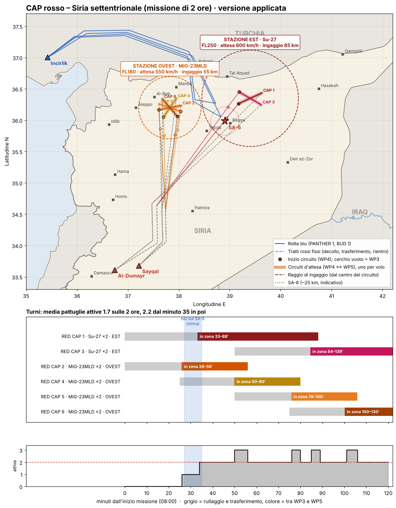

# Missioni

## `Test_siria.miz`

Missione di prova sulla mappa Siria (1 giugno 1999, 08:00, durata prevista 2 ore). Strike/SEAD blu da Incirlik contro un SA-6 vicino a Raqqa. Il giocatore pilota BUD 1-1 (F-15E).

### Pattuglie rosse (CAP)

Sei voli da due aerei, organizzati in modo da avere in media **due pattuglie in zona** (tra WP3 e WP5) dal minuto 35 in poi. Nei primi 26–34 minuti la copertura cresce, perché gli aerei partono da fermi.

| Stazione | Aereo | Centro circuito | Lunghezza | Quota | Velocità in attesa | Raggio di ingaggio |
|---|---|---|---|---|---|---|
| OVEST (Aleppo – Al-Bab – Manbij) | MiG-23MLD da Sayqal | 36,20N 37,825E | 40 km | 18.000 ft | 550 km/h | 55 km |
| EST (Raqqa – Tal Abyad – Hasakah) | Su-27 da Al-Dumayr | 36,35N 39,40E | 45 km | 25.000 ft | 600 km/h | 85 km |

| Volo | Stazione | Partenza | Attesa | Asse del circuito | In zona (min, stima) | Abilità capo / gregario |
|---|---|---|---|---|---|---|
| RED CAP 1 | EST | 08:00 | 50′ | 065°/245° | 33–88 | Excellent / High |
| RED CAP 3 | EST | 08:50 | 50′ | 120°/300° | 84–139 | High / Good |
| RED CAP 2 | OVEST | 08:00 | 25′ | 080°/260° | 26–56 | High / Good |
| RED CAP 4 | OVEST | 08:25 | 25′ | 035°/215° | 50–80 | Good / Good |
| RED CAP 5 | OVEST | 08:50 | 25′ | 110°/290° | 76–106 | High / Average |
| RED CAP 6 | OVEST | 09:15 | 25′ | 140°/320° | 100–130 | Good / Average |

Cosa è stato modificato:

- **Voli esistenti** RED CAP 1 e 2: solo WP3–WP5, il raggio di ingaggio, il circuito (quota, velocità, durata), l'orario di partenza e le abilità.
- **Voli nuovi** RED CAP 3–6: copie dei due voli esistenti, con lo stesso decollo, trasferimento, rientro, carico e livrea. Cambiano solo le stesse voci.
- Il resto della missione è identico all'originale.

Note:

- Il circuito d'attesa va avanti e indietro tra WP4 e WP5. La durata è un tempo fisso, ma gli AI rientrano prima se scendono sotto la soglia di carburante.
- I voli nuovi usano gli stessi posti parcheggio del volo da cui sono copiati: quando partono, il volo precedente ha già lasciato il parcheggio. Le coordinate del parcheggio sono legate al posto e il `.miz` non contiene la tabella dei parcheggi della base, quindi questa era l'opzione più sicura.
- I tempi "in zona" includono circa 5 minuti stimati per rullaggio e decollo.
